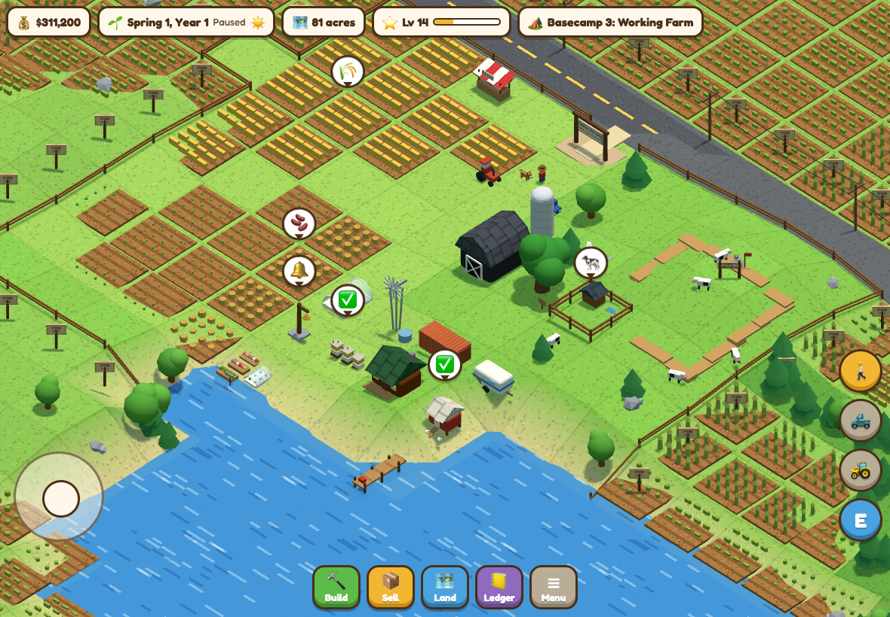

# Freewalker Farms: The Legacy of the 80

**Build the land. Build the business. Build the legacy.**

A private, single-player farming, land and business game for the family, built around our 80 acres in Nebraska. Inherit the 80, build Freewalker Basecamp, farm, open the Farm Stand, buy and lease neighboring land, fish Lake Stillwater with Ace, and grow toward a 1,000-acre Freewalker empire. There is no winning screen — there is always more to build.

*Craft the life. Forge the future.*



## Run it on your computer

You need [Node.js](https://nodejs.org) 20 or newer.

```bash
npm install
npm run dev          # open the address it prints (usually http://localhost:5173)
```

Other commands:

| Command | What it does |
|---|---|
| `npm test` | Simulation unit tests (Vitest), including a 100-year auto-played game |
| `npm run test:e2e` | End-to-end tests in a real browser at iPad and phone sizes (Playwright) |
| `npm run screenshots` | Captures the key scenes into `screenshots/` with a contact sheet at `screenshots/index.html` |
| `npm run build` | Production build into `dist/` |
| `npm run preview` | Serves the production build at http://localhost:4173 |
| `node scripts/make-icons.mjs` | Regenerates the app icons |

The first time you run the browser tests: `npx playwright install chromium`.

The asset gallery (every model in the game) is at `/dev/gallery.html` in dev mode.

## Deploy to GitHub Pages

The workflow in `.github/workflows/deploy.yml` builds and publishes the game whenever `main` is pushed.

1. Create a repository on GitHub (it can be private if your plan allows private Pages; otherwise the code is public but nothing links to it).
2. Push this folder to its `main` branch.
3. On GitHub: **Settings → Pages → Build and deployment → Source: GitHub Actions**.
4. Watch the **Actions** tab; when it's green, the game is at `https://<your-username>.github.io/<repo-name>/`.

The build sets the right subpath automatically from the repository name (`BASE_PATH`). To test a subpath build locally:

```bash
BASE_PATH=/FreewalkerFarms/ npm run build
npx vite preview --base /FreewalkerFarms/    # then open http://localhost:4173/FreewalkerFarms/
```

## Play it on the iPad

1. Open the game's address in **Safari**.
2. Tap **Share → Add to Home Screen**. This matters: Safari can delete a website's saved data if it isn't opened for about a week, but games added to the Home Screen keep their saves. It also plays full-screen and works offline.
3. Launch it from the Home Screen icon from then on.

**Saves** happen automatically after every action, every in-game hour and whenever you leave the app. There are 3 farm slots, so each family member can have their own. Each slot keeps its last 3 autosaves; if the newest is ever damaged, the previous one loads and the game tells you.

**Backups / moving to another device:** Menu → **Export save** downloads a `.json` file. On the other device, tap **Import save** on the title screen. (Saves live in each browser; there is no cloud sync yet.)

### Controls

| | iPad / touch | Keyboard + mouse |
|---|---|---|
| Look around | drag with one finger | drag |
| Zoom | pinch | mouse wheel |
| Select a tile / building | tap | click |
| Walk / drive | joystick (bottom left) | WASD or arrow keys |
| Switch vehicle | buttons on the right | same |
| Interact with the tile you're on | **E** button | E |
| Menu / pause | ☰ Menu | Esc |
| Draw roads, trails, fences | pick it in Build, then drag one finger (two fingers pan) | drag |

A new farm starts with a short tutorial; Menu → **Replay the tutorial** shows it again.

## Edit the map to match the real property

Everything about the home 80 is in **`src/sim/map/home80.ts`**:

- `HOME_ROWS` is a picture of the property, one character per acre: `C` cropland, `P` pasture, `W` Lake Stillwater, `.` not ours. North (the top row) is next to the county road.
- `LANDMARKS` places the Gravel Entrance, **Buffalo Ridge** and the **Sentinel Tree** (column, row within `HOME_ROWS`).
- `LAKE` sets where the lake spreads into the neighbors' land; `COUNTY_ROAD_Y` and `HOME_ORIGIN` place the road and the property in the wider world.

After editing, run `npm test`. The tests check there are still exactly 43 cropland and 37 pasture acres, that the land touches the road and the lake, and that Buffalo Ridge is the highest point (update the test in `tests/sim/core.test.ts` if the real numbers differ).

Saved games keep the map they started with; start a new farm to see map edits.

## How the code is laid out

| Folder | What's in it |
|---|---|
| `src/sim/` | The whole game simulation: pure TypeScript, no browser code, deterministic from a seed. Content (buildings, crops, items) lives in `src/sim/content/`. |
| `src/render/` | Three.js: the isometric camera, terrain, and every model built from code (`meshes.ts`). |
| `src/ui/` | The HTML overlay: HUD, menus, dialogs, tutorial. Features plug in through `src/ui/registry.ts`. |
| `src/save/` | Save slots in IndexedDB with rotation and fallback, behind an interface a cloud backend could implement later. |
| `tests/` | `sim/` unit tests, `e2e/` browser tests, `screens/` screenshot capture, `fixtures/` an old save that must always load. |

Design choices and numbers (prices, speeds, timings) are written down in [`DECISIONS.md`](DECISIONS.md).

### Adding content later (expansion packs)

New buildings, crops, items, tenants, fish and upgrades are entries in data lists (`src/sim/content/*.ts`, `TENANTS` and `UPGRADES` in the sim, `MODELS` in `src/render/meshes.ts`), and new UI hooks into `src/ui/registry.ts`. If an expansion adds fields to the saved game, bump `SAVE_VERSION` and add a migration in `src/sim/save.ts` so old farms keep loading.

## Credits

Game design, family, land and story: the Freewalker family.
Font: [Fredoka](https://github.com/hafontia/Fredoka-One), SIL Open Font License (`src/ui/fonts/OFL.txt`).
All models, textures and icons are generated by code in this repository.
